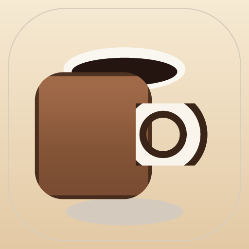

<div align="center">



# Pour Over Focus

**A gamified coffee-shop Pomodoro timer.** Order a drink, brew it, focus while it steeps,
earn cash, and spend it on café themes, fonts, backgrounds and celebration animations.

<p>
  <a href="https://MATTPASSIONFORTECH.github.io/pour-over-focus/"><b>▶ Open the live app</b></a>
  &nbsp;·&nbsp;
  <a href="docs/features.md">Feature reference</a>
  &nbsp;·&nbsp;
  <a href="docs/deployment.md">Deploy your own</a>
</p>

<p>
  
  
  
  
</p>

<sub>Two files of HTML, no frameworks, no build step, no account, no tracking.</sub>

</div>

---

## Start here

Pick a door — everything else in this README is optional reading.

| I want to… | Where to go |
| :-- | :-- |
| **Use the app right now** | [Open the live app](https://MATTPASSIONFORTECH.github.io/pour-over-focus/) · or [run it locally](#run-it-locally) in 10 seconds |
| **Keep it on my phone or desktop** | [Install it](#install-and-offline) — it becomes a real app icon |
| **Understand every feature** | [Feature menu](#feature-menu) ↓ |
| **See the exact numbers** (prices, rewards, achievements) | [docs/features.md](docs/features.md) |
| **Publish my own copy on GitHub Pages** | [Deploy to GitHub Pages](#deploy-to-github-pages) · [in depth](docs/deployment.md) |
| **Change themes, achievements or mechanics** | [docs/architecture.md](docs/architecture.md#extending) |
| **Know where my data lives** | [Data and privacy](#data-and-privacy) |

---

## Feature menu

Every feature has a collapsible card — tap to expand. The full walkthrough with all
prices, tables and edge cases lives in **[docs/features.md](docs/features.md)**.

| | Feature | In one line |
| :-- | :-- | :-- |
| ☕ | [The order ritual](#the-order-ritual) | 4 steps, 4,800 possible drinks, each one rendered as liquid in a cup |
| 🎬 | [The brew cinematic](#the-brew-cinematic) | A short grind-and-pour sequence before every focus session |
| ⏳ | [The focus timer](#the-focus-timer) | Drift-free Pomodoro with breaks, rounds, PiP window and notifications |
| 💰 | [Cash, streaks and sessions](#cash-streaks-and-sessions) | $5 per finished round, daily streaks, session summaries |
| 🛍️ | [The shop](#the-shop) | 19 cosmetic unlocks across skins, fonts, backgrounds and animations |
| 🏆 | [Achievements](#achievements) | 10 badges with live unlock checks |
| 🥇 | [Leaderboard](#leaderboard) | Real-time ranks over SSE — with a graceful offline mode |
| ⚙️ | [Settings and backup](#settings-and-backup) | Timer lengths, focus category, JSON export/import |
| 🍅 | [Glass Timer](#glass-timer) | A second, minimal 25/5/15 Pomodoro page that saves itself as one file |
| 📲 | [Install and offline](#install-and-offline) | Installable PWA with a service worker and maskable icons |

---

## The order ritual

<details open>
<summary><b>Four steps, 4,800 drinks, zero typing</b></summary>

<br>

1. **Drink** — Coffee, Matcha or Espresso Shot.
2. **Milk** — Whole, Coconut, Almond, Oat, or none.
3. **Creamer** — Vanilla, Hazelnut, Caramel, Mocha, or none.
4. **Toppings** — Cinnamon, Rose Petals, Sugar, Cookie Sprinkles, Gingerbread Crumbles,
   Cocoa Dust. **Multi-select**: any combination, including none.

That is `3 × 5 × 5 × 64` = **4,800** distinct orders. Your choices are pre-filled with a
sensible default, so you can hit **Next →** four times and start focusing without deciding
anything. A summary line reads your drink back to you as you go, and the brew screen pours
your exact selection into the cup (colour, creamer swirl, topping garnish) — **[docs/features.md](docs/features.md#the-order-ritual)**.

</details>

---

## The brew cinematic

<details>
<summary><b>A deliberate pause between ordering and focusing</b></summary>

<br>

After the last step, the app brews for **20 seconds** by default (adjustable 5–120s) while
the cup fills and steam rises. Click **☕ Brew** to skip ahead — nothing is locked, the
ritual is there to give your brain a clean hand-off into focus mode.

- Brew length is a setting, not a constant (`Settings → Brew time`).
- Sound effects are synthesized live with the Web Audio API — no audio files ship with the app.
- The brew has a real progress bar driven by the same clock as the timer, so it never lags.

</details>

---

## The focus timer

<details>
<summary><b>Drift-free rounds, breaks, rounds, PiP and notifications</b></summary>

<br>

| Piece | Behaviour |
| :-- | :-- |
| **Clock** | Stored as an end timestamp, not a countdown — sleeping the laptop or switching tabs cannot make it drift |
| **Rounds** | Default 4 focus rounds with short breaks between, a long break after the last |
| **Controls** | Pause / resume, skip the current phase, end the session early |
| **Reload recovery** | The live session is snapshotted; reload or reopen and the timer resumes where it should be |
| **Space bar** | Pause / resume when the timer screen is in front (and no button has focus) |
| **PiP window** | ⧉ opens the timer in a floating always-on-top window (Chrome / Edge, Document Picture-in-Picture) |
| **Notifications** | 🔔 nudges you when a round ends — but only while the tab is hidden, so it never nags you twice |
| **Background audio** | 🎵 café ambience generated from filtered brown noise with a slow breathing LFO |

</details>

---

## Cash, streaks and sessions

<details>
<summary><b>The economy in four numbers</b></summary>

<br>

- **+$5** for every completed focus round.
- A **session** is your configured number of rounds (default 4) → **+$20** for a full session.
- Your **balance** is spendable in the shop; skipping or ending early pays nothing.
- A **daily streak** 🔥 counts consecutive days with a finished round.

Finishing a session opens a stat card with rounds, minutes and cash earned, plus a random
quote from the café wall.

</details>

---

## The shop

<details>
<summary><b>19 cosmetics and 5 celebration tiers</b></summary>

<br>

| Category | What it changes | Items |
| :-- | :-- | :-- |
| **Skins** | The whole palette | Cozy Brown Café *(free)*, Matcha Mode $20, Dark Roast $20, Espresso Black $15, Sunset Glow $25 |
| **Fonts** | Typography | Modern Sans *(free)*, Cute Handwritten $12, Elegant Serif $12, Pixel Retro $15 |
| **Backgrounds** | Animated scenes | Coffee Steam *(free)*, Bookshelf $25, City Patio $35, Rainy Window $40, Fireplace $45 |
| **Celebrations** | The end-of-round payoff | Steam $10, Confetti $25, Golden Glow $50, Fireworks $75, Café Festival $120 |

Every item previews on hover and applies instantly on purchase, and purchases persist across
reloads. Prices and rarities: **[docs/features.md](docs/features.md#the-shop)**.

</details>

---

## Achievements

<details>
<summary><b>10 badges, checked as you play</b></summary>

<br>

| Badge | Unlock condition |
| :-- | :-- |
| ☕ First Brew | Finish your first focus round |
| 🍵 Round Regular | Finish 10 focus rounds |
| 🏆 Barista Legend | Finish 50 focus rounds |
| 💰 $100 Earned | Accumulate $100 in lifetime earnings |
| 🛍️ Big Spender | Own 3 shop items |
| 🥐 Half Dozen | Complete 5 full sessions |
| 🔥 On a Roll | Reach a 3-day streak |
| ⚡ Weekly Warrior | Reach a 7-day streak |
| 🎬 Brewed With Intention | Run a session through the full brew ritual |
| 🎆 Premium Patron | Buy the Legendary Café Festival animation |

Open 🏆 in the header to see locked and unlocked badges side by side.

</details>

---

## Leaderboard

<details>
<summary><b>Live ranks — and what happens without a server</b></summary>

<br>

The 🏅 leaderboard ranks brewers **today** or **all-time** by focus minutes, highlighting
your own row. It is powered by a tiny optional backend (`api/leaderboard`, `api/stream` over
Server-Sent Events, `api/report`), so ranks update live while the modal is open.

You can finish a round with no server at all: reporting is fire-and-forget, and the panel
simply shows **“○ Offline — start the server”** instead of failing. GitHub Pages is static,
so the live leaderboard is the one feature that needs you to run
[the backend](docs/deployment.md#optional-the-leaderboard-backend) yourself.

</details>

---

## Settings and backup

<details>
<summary><b>Control the clock, name your focus, move your save</b></summary>

<br>

| Setting | Range | Default |
| :-- | :-- | :-- |
| Focus length | 1–120 min | 25 |
| Short break | 1–60 min | 5 |
| Long break | 5–90 min | 15 |
| Rounds per session | 1–12 | 4 |
| Brew time | 5–120 s | 20 |
| Focus category | Study / Work / Creative / Reading / Custom | Study |

**💾 Export save** downloads your progress as JSON; **📥 Import save** restores it — handy for
moving between devices or backing up a streak. Your data stays in `localStorage`; the app also
asks the browser for persistent storage so it isn't evicted.

</details>

---

## Glass Timer

<details>
<summary><b>A second page that is a whole Pomodoro in one file</b></summary>

<br>

[`pomodoro.html`](pomodoro.html) is a deliberately minimal, glass-styled 25/5/15 Pomodoro:
a dial, start/pause/reset/skip, and session dots — about 2% JavaScript. Its **⬇ Download Web
App** button saves the current page as a standalone `my-app.html` you can keep forever and
open from disk, with no server and no install.

It is a separate page (not part of the installable app shell), and it is precached too, so
once you have opened the app it works offline: `/pomodoro.html`.

</details>

---

## Install and offline

<details>
<summary><b>How the PWA actually installs, and what works without a network</b></summary>

<br>

| Piece | Detail |
| :-- | :-- |
| **Manifest** | `manifest.webmanifest` — standalone display, portrait, café theme colours, `192`/`512` icons plus dedicated **maskable** icons with safe-zone padding so Android adaptive masks don't crop the cup |
| **Service worker** | `sw.js` — precaches both pages, icons, splash art and drink images on install |
| **Navigations** | Network-first, cached **per URL**, falling back to that page and then the app shell, so one page can never overwrite another's offline copy |
| **Assets** | Cache-first, and only `2xx` responses are stored — a transient 404 can't get pinned in the cache |
| **Updates** | Bump `VERSION` in `sw.js` to publish a new shell; stale caches are deleted on activate and the app re-checks hourly |
| **Install button** | ⬇ appears in the header when the browser offers a prompt; on iOS it explains **Share → Add to Home Screen** instead of doing nothing |

**Desktop:** use the ⬇ button, or your browser's *Install app* menu entry.
**iOS / iPadOS:** Share ⬆️ → **Add to Home Screen**.
**Android:** Chrome menu → **Add to Home screen** / **Install app**.

Once installed it opens without a browser frame and works with the network off — including
the second page and the shop art. Deep dive: **[docs/deployment.md](docs/deployment.md#offline-and-caching)**.

</details>

---

## Run it locally

No install, no build step. Two options:

```bash
# 1. Serve the folder (a service worker needs http://, not file://)
python3 -m http.server 8000
#    → http://localhost:8000/

# 2. Or clone it first
git clone https://github.com/MATTPASSIONFORTECH/pour-over-focus.git
cd pour-over-focus && python3 -m http.server 8000
```

`npx serve .` works just as well. Opening `index.html` directly from disk still shows the app,
but installing and offline caching need a real origin.

---

## Deploy to GitHub Pages

The repo ships with a workflow that publishes the app on every push to `main`.

```bash
# 1. Create the repository (once)
git remote add origin https://github.com/MATTPASSIONFORTECH/pour-over-focus.git
git push -u origin main

# 2. In GitHub: Settings → Pages → Build and deployment → Source: "GitHub Actions"
```

Then **every push to `main` deploys** to
`https://MATTPASSIONFORTECH.github.io/pour-over-focus/` — no build command, no branch to
keep clean. The workflow (`.github/workflows/pages.yml`) stages only the app shell
(`index.html`, `pomodoro.html`, `sw.js`, `manifest.webmanifest`, `404.html`, `assets/`), so
the README and docs never end up on the public site.

> **Forking or renaming the repo?** The links above point at this repo's Pages URL. Swap the
> owner in all of them with:
>
> ```bash
> perl -pi -e 's/MATTPASSIONFORTECH/<your-username>/g' README.md docs/deployment.md
> ```

Every app path is relative, so the project sub-path (`/pour-over-focus/`) just works — the
service worker scopes itself to the folder it is served from. Prefer a branch deploy with no
Actions? Point Pages at `main` / root; the included `.nojekyll` keeps Jekyll's hands off the
files. Full walkthrough, custom domains, cache troubleshooting and the optional leaderboard
backend: **[docs/deployment.md](docs/deployment.md)**.

---

## Project structure

```
pour-over-focus/
├── index.html                 # the whole app: markup, CSS and JS in one file
├── pomodoro.html              # standalone Glass Timer page
├── sw.js                      # service worker: precache, offline routing, updates
├── manifest.webmanifest       # PWA identity, icons, theme
├── 404.html                   # branded not-found page that links home
├── assets/
│   ├── icons/                 # app icons + maskable + apple-touch-icon
│   ├── splash/                # 14 iOS launch images
│   └── img/                   # drink photography used on the brew cards
├── docs/
│   ├── features.md            # complete feature reference (tables, prices, mechanics)
│   ├── deployment.md          # hosting, Pages, offline/caching, leaderboard backend
│   └── architecture.md        # how the code is organised, and how to extend it
├── .github/workflows/pages.yml# deploy to GitHub Pages on push to main
├── CHANGELOG.md
├── LICENSE
└── README.md
```

---

## Docs

| Document | Read it when… |
| :-- | :-- |
| [docs/features.md](docs/features.md) | you want every screen, option, price and mechanic spelled out |
| [docs/deployment.md](docs/deployment.md) | you are hosting it, debugging caching, or wiring the leaderboard |
| [docs/architecture.md](docs/architecture.md) | you are editing the code — state shape, rendering, service worker, how to add content |
| [CHANGELOG.md](CHANGELOG.md) | you want to know what changed in this restructure |

---

## Data and privacy

- Everything you earn, unlock and configure lives in **`localStorage`** on your device
  (`pourFocus.save.v1`, plus a `pourFocus.session.v1` timer snapshot). Older saves from the
  pre-rename key `cozycup.save.v1` are migrated automatically.
- The app ships **no analytics, no fonts, no CDNs, no cookies** — it never phones home.
- The only outbound request is the optional leaderboard `POST` / SSE connection, and only
  when that backend exists. Export your save any time from Settings.

---

## Known limits

- **Live leaderboard needs a backend.** On static hosting the panel shows an offline state;
  everything else works normally. See [deployment docs](docs/deployment.md#optional-the-leaderboard-backend).
- **Picture-in-Picture needs Chromium** (Document PiP API). Elsewhere the ⧉ button is a no-op
  and the timer stays in the tab.
- **iOS installs are manual** — Safari has no install prompt, so use Share → Add to Home Screen.
- **`.webmanifest` MIME matters.** Most hosts serve `application/manifest+json`; if a host
  returns `application/octet-stream`, Chrome ignores the manifest and the app won't install.

---

## Contributing

Ideas are welcome — new skins, achievements, drinks, sounds, or a leaderboard backend that
runs on a serverless function. Content is data-driven and easy to extend
([guide](docs/architecture.md#extending)), and there is no build step to fight. Open an issue
with the idea, or send a PR with the change plus a short note on how you verified it.

---

## License

[MIT](LICENSE) — use it, fork it, ship it, rename the café.

<div align="center">
<sub>Brewed with ☕ · <a href="#pour-over-focus">back to top</a></sub>
</div>
